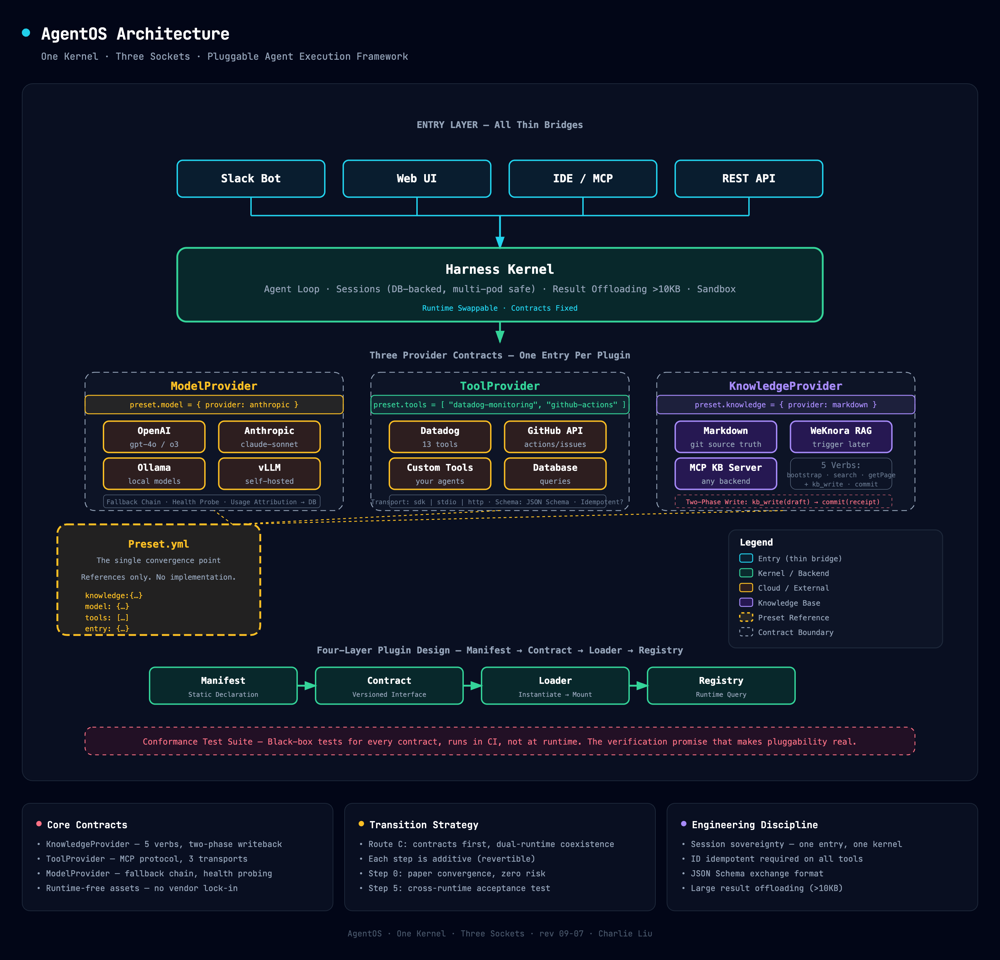

# AgentOS

> **一个内核，三个插座。**

AgentOS 是**可插拔的 Agent 执行框架**：一个 Harness 内核承载 agent 循环、会话和沙箱；三层 Provider 契约（Model / Tool / Knowledge）让模型、工具、知识库随时更换——**换业务 = 换 preset 文件，不动任何代码**。

[English](README.md) · [文档](docs/index.md) · [安全策略](SECURITY.md) · [变更日志](CHANGELOG.md) · [贡献指南](CONTRIBUTING.md)

---

## 目录

- [核心主张](#核心主张)
- [架构概览](#架构概览)
- [三契约](#三契约)
- [四层插件设计](#四层插件设计)
- [知识库](#知识库)
- [过渡路线](#过渡路线)
- [工程纪律](#工程纪律)
- [快速开始](#快速开始)
- [决策记录](#决策记录)
- [待定决策](#待定决策)

---

## 核心主张

| # | 主张 |
|---|------|
| 1 | **契约不变，宿主可换** — 同一组接口可以同时接不同的 Agent 运行时 |
| 2 | **插座已经存在，只是没显式化** — 现有框架里散落的模型路由、工具注册、知识注入可以收敛成统一的显式契约 |
| 3 | **「换业务 = 换 preset」是差异化** — 一个 preset 文件引用所有 provider，不写任何实现 |

---

### 个人工作台

五个面共用同一个内核,而且每一个都是配置或数据——没有任何一个需要改内核:

| 面 | 所在 | web 可写? |
|----|------|-----------|
| 待办 | `.agentos/` 数据(+ 模型调用的 `todo_*` 工具) | 可写 |
| 角色 | `config/agents/*.yml` | 不可——yml + git |
| Workflow | `config/workflows/*.yml`(+ `config/projects` 模板) | 仅可触发 |
| 项目 | 模板在 `config/projects/*.yml`,实例在 `.agentos/` | 实例:仅标题/数据 |
| 外部 agent | `config/tools/*.yml`(MCP 是唯一路径) | 不可 |

## 架构概览



*交互式 HTML 版本（含导出选项 PNG/PDF）：[.docs/architecture-diagram.html](.docs/architecture-diagram.html)*

**租户模型：** 一业务 = 一 preset 文件（provider 选择 + workspaceId + tokenEnv）；凭证只走环境变量，不进 preset。

---

## 三契约

### KnowledgeProvider — 知识库可插拔

会话注入 → 检索 → 两段式反写（kb_write 草稿 / kb_commit 确认落库）

```ts
interface KnowledgeProvider {
  bootstrap(preset): DirectoryIndex        // 导览：目录 + 最近更新
  search(q, limit): SearchHit[]            // 按关键词/语义搜
  getPage(id): PageContent                 // 读原文
  listPages(scope): IndexEntry[]           // 索引列表
  writePage(draft): Receipt                // 两段式：先落草稿
  commit(receipt): void                    // 确认后写入 git PR
}
```

| 实现 | 状态 | 说明 |
|------|------|------|
| `provider-markdown` | v0.1 可用 | 零依赖兜底，git + markdown 为源真相层 |
| `provider-weknora` | 触发后 | RAG + Wiki UI + 多租户（数十~数百页后启用） |
| `provider-mcp` | 规划中 | 任意 KB server 通过 MCP 协议接入 |

### ToolProvider — MCP 可插拔

一个工具服务器 = 注册表一条声明式 entry，运行时按 transport 挂载。

```yaml
# config/tools/datadog.yml —— schema: packages/contracts/src/tool.ts
kind: tool
version: "1"
name: datadog
transport: http                 # sdk | stdio | http
endpoint: https://${DATADOG_MCP_HOST}/rpc
auth: { mode: bearer-token-env, env: DATADOG_TOKEN }   # 只写 env 变量名
allowedTools: ["dd_*"]          # 可选；缺席 = 放行全部发现工具（drift 标记为未验证）
envRouting: ["non-prod"]        # 可选数组；缺席 = 所有环境挂载
idempotent: { default: false, overrides: { dd_search_logs: true } }  # 可选；缺席 = 永不重试
schemaExchange: json-schema
```

**挂载规则：** 逐条挂载，单条失败 = 缺席 + 告警，不拖垮整体；启动期漂移检查（声明 vs 实际发现的工具）。

### ModelProvider — 模型可插拔

三层优先级路由（请求覆盖 → 频道/租户配置 → 全局默认），带降级链。

```yaml
# config/models/deepseek.yml —— 是租约，不是代码
kind: model
version: "1"
name: deepseek
provider: deepseek
dialect: anthropic-compat        # 可选运行时方言（anthropic-compat | bedrock | openai-compat）
baseUrlEnv: AGENTOS_DEEPSEEK_ANTHROPIC_BASE_URL   # env 变量名，不是 URL
credentialsEnv: AGENTOS_DEEPSEEK_API_KEY          # env 变量名，不是 key
models: { general: deepseek-chat, reasoner: deepseek-reasoner }
fallbackChain: [general]         # 本 manifest 内的别名
usageAttr: { costCenter: platform-eng }           # 归因标签 → usage.log
```

---

## 四层插件设计

知识库、模型、MCP 工具、入口 —— 四层**不各做一套机制**，共享同一个四元组：

```
Manifest（静态声明） → Contract（版本化接口） → Loader（实例化→挂载） → Registry（运行时查询）
```

preset 是四层的唯一汇合点：一个业务的 preset 只做**引用**，不写任何实现。

```yaml
# config/presets/example.yml —— 一业务一份；换业务 = 换这一个文件
kind: preset
version: "1"
name: example
knowledge: local-markdown       # 引用 config/ 中的 manifest 名字，零内联配置
model: deepseek
tools: [mcp-filesystem, datadog ]
entry: cli                      # 代码注册的 adapter 名（cli | rest）
# channelModels: { rest: deepseek }   # 可选中间层：频道/租户 → 模型
# 凭证永不进 manifest，只留 env 变量名引用（baseUrlEnv / credentialsEnv / auth.env）
```

### EntryAdapter — 入口层（最后补，非先行）

入口插件 ≠ 每客户端一套，而是只抽四件跨层翻译：

| 方法 | 职责 |
|------|------|
| `identity()` | 凭证 → `{ userId, tenant }`（API key / OAuth / Slack mapping） |
| `session()` | 客户端会话 ↔ agent session 映射 |
| `render()` | SSE 事件流 → 该客户端呈现（透传 / Block Kit / 文本） |
| `confirm()` | 确认交互能力声明（决定知识写权限） |

### Conformance Test Suite

每个契约配一组「任何实现必须通过」的黑盒测试，跑在 CI 而非运行时。有了它，插件化才不是架构美学而是可验证承诺；它同时是未来第三方接入者唯一的说明书。

### 落地顺序

| Step | 做什么 | 状态 | 验收 | 为什么在这 |
|------|--------|------|------|-----------|
| 0 | Manifest 元 schema + 四契约 | **已交付** | 每份契约能描述一个已有系统 | 纸面收敛，零风险 |
| 1 | MCP 注册表改 manifest 驱动 | **已交付** | 改造前后工具集零差异 | 有参照物，机制最容易显形 |
| 2 | 第二个外部项目经 manifest 接入 | **计划中**（#304） | 幂等声明生效、非幂等工具被保护 | 仍需一个真实第二方压测 |
| 3 | 第三方 ModelProvider 方言 | **已交付** | 一次请求内换 provider，路由/降级正常 | `model-anthropic-compat` / `model-bedrock` / `model-openai-compat` |
| 4 | EntryAdapter 两个实现：CLI + REST | **已交付** | 同一 preset 两端跑同一次对话 | Slack 是已拒绝边界（#171），CLI/REST 是参考实现对 |
| 5 | 跨运行时 conformance | **计划中**（#144/#298） | 同一 preset 在两个运行时各跑通全流程 | 依赖前四步格式稳定 |

### 三个反模式（已否决）

| # | 反模式 | 状态 | 替代方案 |
|---|--------|------|---------|
| ① | 自造工具协议 | 已否决 | 工具层直接用 MCP，只管挂载不管定义 |
| ② | 热插先于启动加载 | 已否决 | 第一步只做「启动期读 manifest」，运行时热插是最后一个里程碑 |
| ③ | 一个入口两个内核 | **第一天定死** | channel →（内核, preset）路由表，禁止两边接同一 thread |

---

## 知识库

### 七通道知识注入

| # | 通道 | 知识类型 | 谁触发 | 成本模式 | 放什么 |
|---|------|---------|--------|---------|--------|
| 1 | System prompt | 规矩 | 代码拼装 | 每圈全量付费 | 极小+每圈必用（HARD RULE） |
| 2 | CLAUDE.md 分层 memory | 项目知识 | 自动加载 | 启动常驻 | 小而稳+全员必用+坑位记录 |
| 3 | Skills | 程序性知识 | 菜单常驻 | 菜单税+按需一次 | SOP / 操作规程 |
| 4 | MCP 工具 | 动态事实 | 模型调用 | 按需，可落盘 | 现查类（监控系统、API 查询） |
| 5 | Workspace 文件 | **静态资料库** | Read/Grep | **零协议成本** | **几十~几百份 md 知识仓 + 导览 + 反写草稿 —— 主战场** |

> 通用 Agent 框架没有内置 RAG —— 大事实库必须自己做成通道 4/5 的组合。

### 规模甜蜜点：几十~几百份不需要向量检索

全库摘要索引 ≈ 1-2K token，目录菜单全量常驻 = 检索问题当场消解；正文按需 Grep（词面匹配对内部文档精度反而高于语义）。上检索层的四条触发线：>150 页 / 改写差距出现 / 非 git 受众 / 跨租户共享 —— 满足任意两条再动。

### 演化阶梯与插槽裁决

| 插槽 | 住在这里的候选 | 裁决 |
|------|--------------|------|
| 源真相层（图书馆） | **git + markdown** | 无软件依赖，承重墙，不再动 |
| 编辑/浏览层（人的桌子） | VSCode / Typora / Obsidian | 可与 git 仓叠加，非替代 |
| 索引/检索层（研究院大脑） | LangChain RAG / LlamaIndex / pgvector | 纯算法无产品，几百份不碰 |
| 一站式平台（全打包） | Dify KB / RAGFlow / Outline | 触发后公平比测，license 合规优先 |

### 对接链路：harness 如何见到知识库

```
git + markdown 仓（源真相 · 书）
  ↓ 单向灌入 · reindex.sh 可重跑
知识库引擎（索引层 · 书皮：chunks + 向量 + Wiki UI）
  ↑ 方言止步于这层
provider-<engine>（薄壳 · 唯一真胶水：治理+租户+凭证）
  ↓ 说普通话：MCP
kb-mcp-server（kb_search · kb_get_page · kb_append）
  ↓ MCP 协议 · 谁都能插
LangGraph · CrewAI · AutoGen · 自定义框架
```

**理由：** 方言隔离（引擎细节不出壳）· 治理在壳（反写两段/待审排除/>10KB 落盘）· 一次四通吃（写一次全框架通用）

---

## 过渡路线

三种策略，**推荐路线 C**：

| 路线 | 内核 | 动作 | 结论 |
|------|------|------|------|
| A | 全上某一运行时 | 一切插件化挂到单一框架 | 观察：长上下文工程短期复刻不了 |
| B | 全上另一运行时 | 深度定制适配 | 次选：被上游版本节奏绑定 |
| **C** | **契约先行 · 多运行时并存** | **契约定稿，各运行时各自实现，能力逐步接入** | **推荐** |

### 路线 C · 四步落地（每步可回退）

1. **三个契约定稿** — 只写契约与 schema，runtime-free 资产
2. **引入第一个外部 ToolProvider** — 验证 provider-mcp 路径
3. **给既有系统加一条知识库 entry** — 补充业务知识，原内核不动
4. **跨运行时验收测试** — 同一 preset 在不同运行时各跑通注入→检索→反写

> 「每步可回退」= 每一步都是加法，不修改不删除任何在跑的旧系统。回退 = 撤掉该步新增项。

---

## 工程纪律

| # | 纪律 | 级别 | 说明 |
|---|------|------|------|
| 1 | **会话主权**：一个入口只归一个内核 | 高 | 双内核抢会话 = 上下文劈半、状态对不上账 |
| 2 | **Schema 以 JSON Schema 交换** | 中 | 不同版本的 schema 不兼容会静默丢全部工具 |
| 3 | **idempotent 必填** | 中 | 非幂等工具在自动重试下执行不可逆操作 |
| 4 | **注册表配置驱动** | 纪律 | 多 pod 下禁用 module-level 状态 |
| 5 | **大结果治理进契约** | 纪律 | >10KB 结果落盘、只回指针——对 agentos 自有（sdk transport）工具由 `packages/core/src/governance/offload.ts` 强制执行；内核侧 stdio/http 结果在 #301 落地前仍是内联 |
| 6 | **多 pod 纪律（四条）** | 纪律 | ① 禁止 module-level 共享状态；② 会话状态只存在 ledger；③ 恢复靠重放已存转录，不靠内存 emitter；④ 数据库是唯一事实源。抄的是多 pod 系统换来的纪律，不是它的架构 |

### 什么时候才该换 ledger 数据库

默认是内嵌 `node:sqlite`——零外部依赖启动。所有 ledger 访问都走同一个接口（`packages/core/src/session/ledger.ts`），换驱动是实现替换，不是重写。只有下列触发条件**真的出现**时才换（与 RAG 四触发同构）：

| 触发条件 | 为什么 sqlite 不够 |
|----------|--------------------|
| **并发写冲突**出现（写者排队/阻塞在单文件上） | 内嵌模型就是同一时刻一个写者 |
| **多实例部署**（不止一个进程服务同一批会话） | 没有跨进程协调与故障转移 |
| **> 1 万会话**且历史查询重 | 无索引服务器时全表扫描越来越贵 |

这三条都不是框架需求，而是部署事实。一条都不成立时上 Postgres 是只有成本没有理由。

---

## 数据目录

所有运行时产物从第一天起就只落一个根目录——`.agentos/`（#135）。不做镜像、不做同步：这个布局本身就是部署状态，迁移 = 拷贝。

| 路径 | 内容 |
|------|------|
| `sessions.db` | ledger（id / 状态 / 标题 / 内核指针） |
| `workspaces/<key>/` | 每会话工作区 + `tool-results/` 落盘文件 |
| `kb-drafts/` | 未提交知识草稿（对搜索不可见） |
| `kb-receipts.jsonl` | 草稿 → 提交台账 |
| `usage.log` | 每轮用量归因元数据 |
| `escalations.log`、`audit.jsonl` | 人工移交 + 执行门禁记录 |

此树中的日志只记元数据；永不写入的内容见 `SECURITY.md`。

---

## 快速开始

### 环境要求

- **Node.js ≥ 22.5** —— ledger 使用内置 `node:sqlite` 驱动，该能力从 22.5 起存在（根 package.json 的 `engines` 写作 `>=22`）
- **pnpm ≥ 9** —— 本仓库是 pnpm workspace，`npm install` 不会链接 workspace 包

### 安装

```bash
git clone https://github.com/charlie-bit/agentos.git
cd agentos
pnpm install
pnpm build          # 先让 workspace 包产出 dist/，之后才能运行
```

### 安装(npm)

```bash
npm i -g agentos              # 全局 CLI
# 或免安装运行:
npx agentos preset validate config/presets/example.yml
```

> 打包（spec #145/#299）：CLI 在构建期打包——workspace 包内联，`serve` 为懒加载 chunk，内核 SDK 是唯一声明的运行时依赖。`node scripts/pack-cli-check.mjs` 会 pack、解包到干净目录并在无 checkout 的情况下运行 `preset validate`（可入 CI）。

### 开发

```bash
# 全 workspace
pnpm -r test
pnpm -r typecheck
pnpm -r lint

# 单个包
pnpm --filter @agentos/core test

# 校验随仓库发布的 preset（无副作用）
node cli/main.mjs preset validate config/presets/example.yml
```

### 贡献

详见 [CONTRIBUTING.md](./CONTRIBUTING.md)——provider 实现、preset 编写与边界承诺（`skills/CONTRIBUTING.md` 属于 vendored 第三方插件树，不是本仓指南）。
